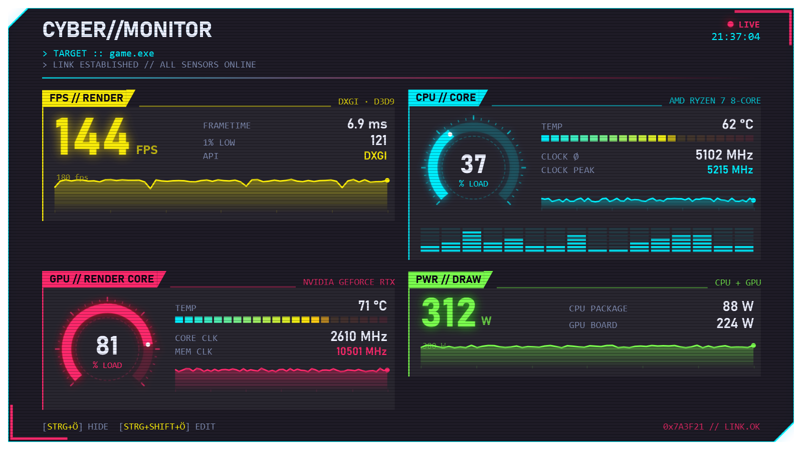
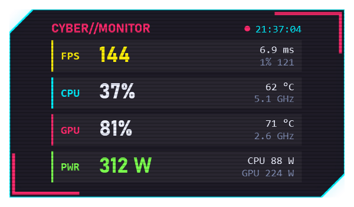
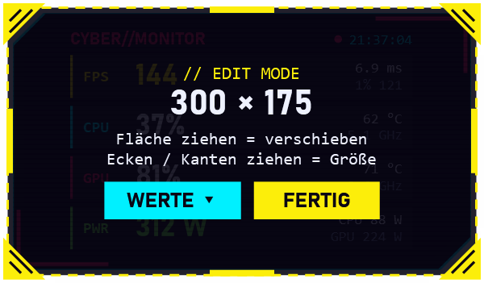
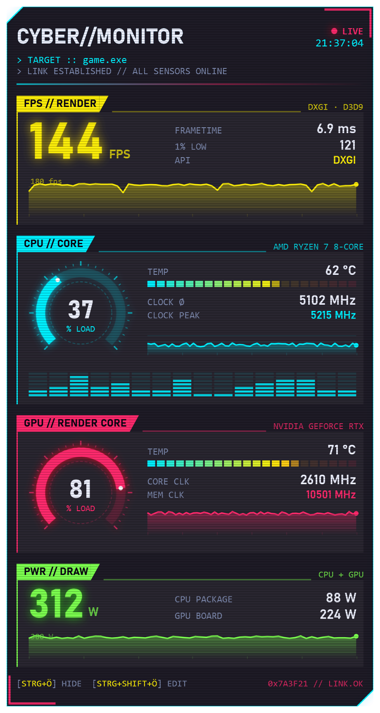

<h1 align="center">CYBER//MONITOR</h1>

<p align="center">
  <b>Hardware-Overlay für Windows 10/11 im Cyberpunk-Look</b><br>
  FPS, CPU, GPU und Stromverbrauch über jedem Spiel, per <b>Strg + Ö</b> ein- und ausblendbar.
</p>

<p align="center">
  <a href="https://github.com/NoobmitHut/CyberMonitor/releases/latest"></a>
  <a href="https://github.com/NoobmitHut/CyberMonitor/releases"></a>
  
</p>

<p align="center">
  
</p>

---

## ⬇ Download

<p align="center">
  <a href="https://github.com/NoobmitHut/CyberMonitor/releases/latest/download/CyberMonitor-win-x64.zip"><b>CyberMonitor herunterladen (Windows, 64 Bit)</b></a>
</p>

| Datei | Für wen | Größe |
|---|---|---|
| [**CyberMonitor-win-x64.zip**](https://github.com/NoobmitHut/CyberMonitor/releases/latest/download/CyberMonitor-win-x64.zip) | **Empfohlen.** Läuft sofort, nichts weiter zu installieren | ca. 75 MB |
| [CyberMonitor-win-x64-net8.zip](https://github.com/NoobmitHut/CyberMonitor/releases/latest/download/CyberMonitor-win-x64-net8.zip) | Klein, braucht die [.NET 8 Desktop Runtime (x64)](https://dotnet.microsoft.com/download/dotnet/8.0) | ca. 5 MB |

Alle Versionen und Änderungen: [Releases](https://github.com/NoobmitHut/CyberMonitor/releases)

## 🚀 Schnellstart

1. **ZIP herunterladen und entpacken**, den Ordner `CyberMonitor` an einen festen Ort legen, z. B. `C:\Tools\CyberMonitor`.
   (Nicht im Download-Ordner lassen, der Autostart merkt sich den Pfad.)
2. **`CyberMonitor.exe` starten.**
   - Zeigt Windows „Der Computer wurde durch Windows geschützt“: **Weitere Informationen → Trotzdem ausführen**.
     Das Programm ist nicht kostenpflichtig signiert, deshalb kennt SmartScreen es noch nicht.
   - Die **Admin-Abfrage (UAC) bestätigen**. Admin-Rechte braucht CyberMonitor für die Hardware-Sensoren und die FPS-Messung.
3. CyberMonitor sitzt jetzt unten rechts im **Tray**. **Strg + Ö** blendet das Overlay ein und aus.
4. **Für CPU-Temperatur und CPU-Leistung** einmal den Treiber [**PawnIO**](https://pawnio.eu) installieren
   (oder in PowerShell: `winget install namazso.PawnIO`) und CyberMonitor neu starten.
   Ohne PawnIO steht im Overlay „PAWNIO FEHLT“; alles andere funktioniert trotzdem.

Beim ersten Start richtet CyberMonitor den **Autostart** ein. Danach startet es bei jeder Anmeldung ohne Admin-Abfrage
im Tray. Abschalten: Rechtsklick aufs Tray-Icon → „Mit Windows starten“.

## 🖥 Ansichten

Das Overlay ist ein frei veränderbares Rechteck, Standard ist **klein oben links**. Der Inhalt passt sich der Form an.

| Klein (Standard) | Bearbeiten-Modus (Strg + Shift + Ö) |
|---|---|
|  |  |

**Flach und breit: Leiste**


<details>
<summary><b>Groß, hochkant: volle Ansicht</b> (aufklappen)</summary>
<br>

</details>

| Rechteck | Ansicht |
|---|---|
| klein | Mini-Ansicht: FPS, CPU, GPU, Strom als Zeilen mit Frametime, Temperatur, Takt |
| flach und breit | Mini-Ansicht als Leiste |
| schmal und hoch | Mini-Ansicht nur mit den Hauptwerten |
| groß, hochkant | volle Ansicht mit Ringen, Verlaufsgrafiken und Kern-Matrix |
| groß, quer | volle Ansicht in 2 bis 4 Spalten |

*Die Bilder zeigen Beispielwerte.*

## 🎮 Bedienung

| Taste / Klick | Wirkung |
|---|---|
| **Strg + Ö** | Overlay ein-/ausblenden |
| **Strg + Shift + Ö** | Bearbeiten-Modus ein/aus (blendet das Overlay bei Bedarf ein) |
| **Strg + Shift + Plus / Minus** | Overlay um 10 % größer/kleiner (nur solange es sichtbar ist) |
| Linksklick aufs Tray-Icon | Overlay ein-/ausblenden |
| Rechtsklick aufs Tray-Icon | Verschieben/Größe, angezeigte Werte, Position, feste Größen, Autostart, Deinstallieren, Beenden |

**Im Bearbeiten-Modus** bekommt das Overlay einen gelben Rahmen:

- **Fläche ziehen**: verschieben
- **Ecken ziehen**: Breite und Höhe ändern, die gegenüberliegende Ecke bleibt stehen
- **Kanten ziehen** (gelbe Striche): nur Breite oder nur Höhe
- **Mausrad**: beides gemeinsam
- **WERTE ▾**: Auswahlmenü, um jeden Wert einzeln ein- oder auszublenden
- **FERTIG** oder erneut Strg + Shift + Ö: fertig, Klicks gehen wieder durch

Das Overlay nimmt nie den Tastaturfokus, das Spiel behält also immer die Tastatur. Größe, Position und Auswahl werden
gespeichert.

## 📊 Was angezeigt wird

| Bereich | Werte |
|---|---|
| **FPS** | FPS, Frametime, 1 % Low, Grafik-API, Verlauf |
| **CPU** | Auslastung, Temperatur, Ø-Takt, höchster Kerntakt, Last pro Thread |
| **GPU** | Auslastung, Temperatur, Kerntakt, Speichertakt |
| **Strom** | Summe CPU + GPU, CPU-Paket, Grafikkarte (Watt) |

Temperaturen werden ab 70 °C gelb und ab 85 °C rot. Die FPS gelten immer für das Programm im Vordergrund
(steht als `TARGET` im Overlay). Der Stromwert ist CPU + Grafikkarte, **nicht** der Verbrauch an der Steckdose
(Mainboard, RAM, Laufwerke, Lüfter und Netzteilverluste fehlen).

## ❓ Fragen und Probleme

<details>
<summary><b>CPU-Temperatur zeigt „PAWNIO FEHLT“</b></summary>

CPU-Temperatur und -Leistung braucht der Treiber [PawnIO](https://pawnio.eu). Einmal installieren
(`winget install namazso.PawnIO` oder Installer von der Webseite), dann CyberMonitor neu starten.
Den CPU-Takt liest CyberMonitor ohne Treiber über die Windows-Leistungszähler (wie der Task-Manager).
</details>

<details>
<summary><b>FPS zeigt 0 oder das Overlay ist im Spiel nicht zu sehen</b></summary>

- Im Spiel **„Randloses Fenster“ / „Borderless“** wählen. Über *exklusives* Vollbild kann kein Overlay-Fenster zeichnen
  (auch Discord oder Steam nicht ohne Hook).
- **Vulkan/OpenGL**: Die FPS werden nur erfasst, wenn der Treiber über DXGI präsentiert. Bei NVIDIA:
  Systemsteuerung → *Vulkan/OpenGL-Present-Methode* → „Auf DXGI-Swapchain bevorzugen“. DirectX 9 bis 12 geht direkt.
- Das Spiel muss das **aktive Fenster** sein (siehe `TARGET` im Overlay).
</details>

<details>
<summary><b>Windows/Virenscanner warnt vor der Datei</b></summary>

CyberMonitor ist nicht kostenpflichtig signiert, deshalb warnt SmartScreen beim ersten Start
(„Weitere Informationen → Trotzdem ausführen“). Manche Virenscanner reagieren auf Programme, die Hardware-Sensoren
und Admin-Rechte nutzen. Der komplette Quellcode liegt hier im Repository; die Release-Dateien baut GitHub Actions
direkt daraus, die SHA-256-Prüfsummen stehen beim Release.
</details>

<details>
<summary><b>Strg + Ö funktioniert nicht</b></summary>

Dann benutzt schon ein anderes Programm die Tastenkombination; das Tray-Icon meldet das beim Start.
Das Overlay lässt sich dann per Linksklick aufs Tray-Icon öffnen.
</details>

<details>
<summary><b>Kostet das Leistung im Spiel?</b></summary>

Ausgeblendet praktisch nichts: keine Sensorabfrage, keine FPS-Messung, keine Animationen, Windows-Effizienzmodus aktiv,
0 % CPU. Eingeblendet: Sensoren 1× pro Sekunde, FPS 2× pro Sekunde, Animationen auf 30 fps begrenzt, niedrige
Thread-Priorität. In das Spiel wird nichts injiziert, deshalb gibt es auch keine Probleme mit Anti-Cheat.
</details>

## 🗑 Deinstallation

- **Rechtsklick aufs Tray-Icon → „Deinstallieren ...“**, oder
- **`Uninstall.bat`** im Programmordner doppelklicken (geht auch, wenn CyberMonitor nicht mehr startet).

Entfernt werden: laufende Prozesse, die Autostart-Aufgabe, Einstellungen und Logs (`%APPDATA%\CyberMonitor`)
und der Programmordner. Gemeinsam genutzte Treiber wie PawnIO bleiben installiert.
Optionen: `Uninstall.bat -Yes` (ohne Rückfrage), `-KeepSettings`, `-KeepFiles`.

<details>
<summary>Von Hand (als Admin)</summary>

```bat
schtasks /Delete /TN CyberMonitor /F
logman stop CyberMonitor-FPS -ets
rmdir /s /q "%APPDATA%\CyberMonitor"
```
</details>

## 🛠 Technik

- **WPF / .NET 8**, ein transparentes, immer obenliegendes Fenster (`WS_EX_TRANSPARENT | WS_EX_NOACTIVATE | WS_EX_TOOLWINDOW`):
  lässt Klicks durch, nimmt nie den Fokus, erscheint nicht in Alt+Tab.
- **Sensoren** über [LibreHardwareMonitorLib](https://github.com/LibreHardwareMonitor/LibreHardwareMonitor) (NVIDIA, AMD, Intel),
  CPU-Takt-Ersatz über die Windows-Leistungszähler.
- **FPS** über ETW-Present-Events (DXGI und D3D9), wie Microsofts PresentMon. Gezählt wird nur die aktivste Swapchain,
  Test-Presents werden ignoriert, Store-/UWP-Spiele werden hinter `ApplicationFrameHost.exe` erkannt.
  **1 % Low** = 99. Perzentil der Frametimes der letzten 5 Sekunden.
- **Hotkeys** über `RegisterHotKey`, **Autostart** über die Aufgabenplanung („bei Anmeldung, mit höchsten Rechten“).
- Einstellungen in `%APPDATA%\CyberMonitor\settings.json` (Größe, Position, angezeigte Werte).

## 🔧 Selbst bauen

1. [.NET 8 SDK](https://dotnet.microsoft.com/download/dotnet/8.0) installieren
2. Repository herunterladen (grüner Knopf **Code → Download ZIP**) und `build.bat` doppelklicken
3. Das Ergebnis liegt in `publish\`

Releases baut [GitHub Actions](.github/workflows/release.yml) automatisch, sobald ein Tag `v*` hochgeladen wird.
`Vorschau.html` zeigt das Overlay mit simulierten Werten im Browser (nur zum Anschauen).

<details>
<summary>Projektstruktur</summary>

```
├─ App.xaml(.cs)            Start, Tray, Hotkeys, Ruhemodus
├─ OverlayWindow.xaml(.cs)  Overlay-UI, Layout-Auswahl, Bearbeiten-Modus
├─ Native.cs                Win32-Interop
├─ Uninstall.ps1 / .bat     Deinstallations-Kit (liegt neben der EXE)
├─ Controls/                ArcGauge, Sparkline, SegmentBar, CoreBars
├─ Services/                HardwareService, CpuPerfClock, FpsService, HotkeyManager,
│                           AutostartManager, TrayIcon, AppSettings, Metrics, Uninstaller
├─ docs/screenshots/        Bilder für diese Seite
└─ .github/                 Release-Workflow und Release-Text
```
</details>

## 📄 Rechtliches

© NoobmitHut. Alle Rechte vorbehalten. Du darfst CyberMonitor herunterladen und privat nutzen.
Den Quellcode weiterzuverwenden, zu verändern oder weiterzugeben ist ohne Erlaubnis nicht gestattet.

CyberMonitor enthält Bibliotheken anderer Projekte unter deren eigenen Lizenzen (u. a. LibreHardwareMonitor, MPL-2.0),
siehe [THIRD-PARTY-NOTICES.md](THIRD-PARTY-NOTICES.md).
